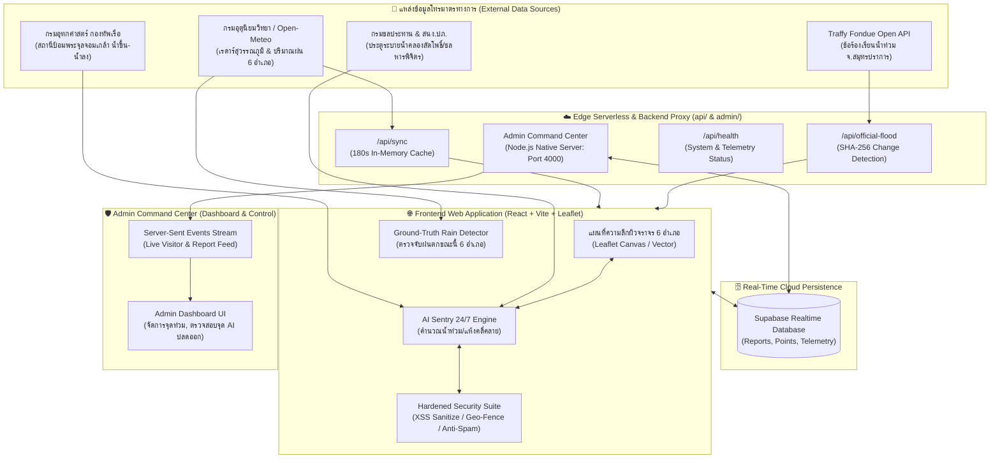
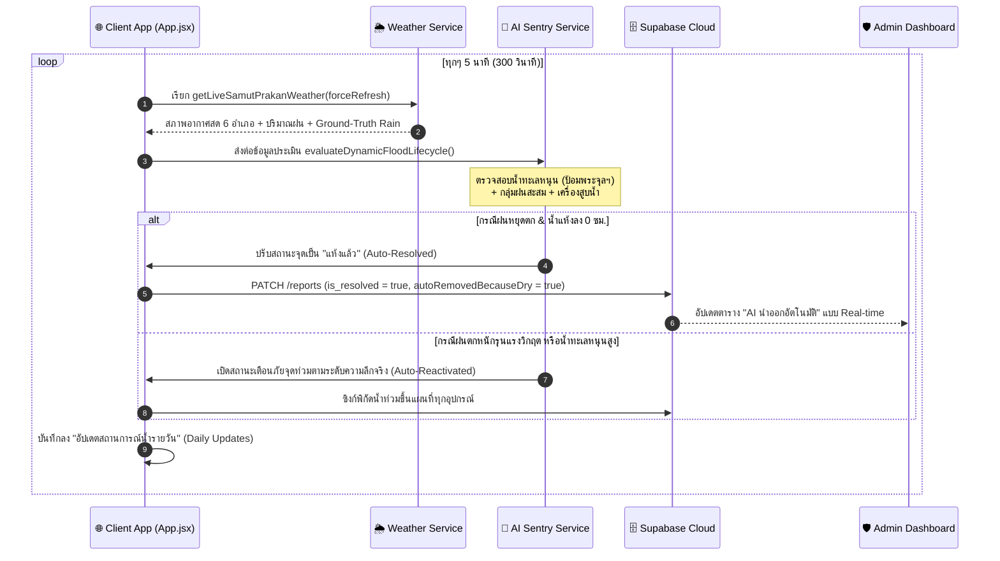

# 🏛️ สถาปัตยกรรมระบบ PrakanGuard (System Architecture & Review Guide)

ระบบสารสนเทศและเฝ้าระวังอุทกภัยผิวจราจร 6 อำเภอ จังหวัดสมุทรปราการ แบบอัตโนมัติ 24 ชั่วโมง (Full-Stack Hydro-Meteorological Intelligence Platform)

---

## 1. ภาพรวมสถาปัตยกรรมระบบ (High-Level Architecture)



---

## 2. โครงสร้างโฟลเดอร์มาตรฐาน Full-Stack (Project Directory Map)

```text
PrakanGuard/
├── .vscode/                     # 🛠️ การตั้งค่า VS Code สำหรับ Code Review & Debugging
│   ├── extensions.json          # แนะนำ Extension ที่จำเป็น (Tailwind, Prettier, ESLint, Mermaid)
│   ├── launch.json              # เมนูกด F5 รัน Debug Frontend + Admin Backend พร้อมกัน
│   ├── settings.json            # ฟอร์แมตโค้ดอัตโนมัติ & Tailwind IntelliSense
│   └── tasks.json               # คำสั่ง Build & Run Tasks (Ctrl+Shift+B)
├── admin/                       # 🛡️ ระบบหลังบ้าน Admin Command Center (Node.js Native + Vanilla SPA)
│   ├── assets/                  # CSS, JS, Vendor (Leaflet, Chart.js)
│   ├── data/                    # ข้อมูล Local Persistence (JSON Cache)
│   ├── database/                # สคริปต์ SQL Schema (Supabase)
│   ├── scripts/                 # สคริปต์ตัวนับผู้เยี่ยมชม (Visitor Tracker)
│   ├── server/                  # สถาปัตยกรรม Modular Backend (Routes, SSE, Storage, Presence)
│   │   ├── routes/              # Reports, Feedback, Stats, Trash, Visitors
│   │   ├── sync/                # Cloud Bridge & Supabase Real-Time Sync
│   │   ├── app.js               # Main HTTP Dispatcher + Hardened Headers + IP Rate Limiter
│   │   └── config.js            # MIME Types & Port Configuration
│   ├── index.html               # หน้าแดชบอร์ดศูนย์บัญชาการแอดมิน
│   └── server.js                # Entry point เซิร์ฟเวอร์แอดมิน (Port 4000)
├── api/                         # ☁️ Vercel Edge Serverless Functions
│   ├── health.js                # Uptime & Telemetry Health Probe (/api/health)
│   ├── official-flood.js        # Traffy Fondue Open API Proxy & SHA-256 Change Detector
│   └── sync.js                  # 180s Multi-Coordinate Weather & Flood Cache
├── docs/                        # 📚 เอกสารสถาปัตยกรรมระบบและคู่มือ
│   ├── ARCHITECTURE.md          # สถาปัตยกรรมระบบและผังการทำงาน (เอกสารนี้)
│   ├── SECURITY.md              # มาตรการความปลอดภัยและนโยบาย Hardening
│   ├── API.md                   # ข้อมูลจำเพาะของ REST API และ SSE Endpoints
│   └── DEPLOY_GUIDE.md          # ขั้นตอนการ Deploy สู่ Vercel / GitHub
├── public/                      # 📦 Static Assets สำหรับ Webapp
│   ├── _redirects               # SPA Routing Rules
│   ├── official-sync-engine.js  # Client Diffing Engine สำหรับ Traffy Fondue
│   └── sync-engine.js           # Client Background Poller
├── scripts/                     # 🚀 เครื่องมืออัตโนมัติและสคริปต์รันระบบ
│   ├── audit_security.js        # สคริปต์สแกนตรวจสอบความปลอดภัย & Integrity แบบอัตโนมัติ
│   ├── deploy_to_github.bat     # บิลด์และ Push ขึ้น GitHub อัตโนมัติ
│   ├── start_admin.bat          # สตาร์ท Admin Server (Port 4000)
│   ├── start_all.bat            # สตาร์ททั้งเว็บหลัก + แอดมินพร้อมกัน
│   └── start_website.bat        # สตาร์ท Vite Frontend Dev Server (Port 5173)
├── src/                         # 🌐 ซอร์สโค้ดหลักฝั่ง Frontend (React 18 + Tailwind CSS)
│   ├── components/              # คอมโพเนนต์ UI (MapView, RainForecast24hCard, Modals)
│   ├── context/                 # React Context State (Auth, Booking, Toast)
│   ├── data/                    # ข้อมูลภูมิสารสนเทศ (Boundary 6 อำเภอ, จุดเฝ้าระวัง 40 จุด)
│   ├── services/                # แกนคำนวณหลัก (AI Sentry, Weather, Security, Cloud Sync)
│   │   ├── aiSentryService.js   # โมเดลประเมินน้ำท่วมและน้ำแห้งคลี่คลาย 24 ชม.
│   │   ├── weatherService.js    # ระบบตรวจจับฝนตกจริง (Ground-Truth Rain Detector)
│   │   ├── securityService.js   # ระบบตรวจจับ XSS, Geo-Fencing, Progressive Lockout
│   │   └── cloudSyncService.js  # Supabase Bridge & EventSource Subscription
│   ├── views/                   # หน้าหลักของระบบ (Home, Analytics, Facilities, Rooms)
│   ├── App.jsx                  # Main Application Component & 5-Minute Sync Loop
│   ├── index.css                # Global Styles & Leaflet Theme Inversions
│   └── main.jsx                 # React DOM Root Entry Point
├── tests/                       # 🧪 ชุดทดสอบมาตรฐานและการตรวจสอบระบบ (Test Suite)
│   ├── e2e/                     # การทดสอบ Responsive และ Device Verification (Puppeteer)
│   ├── integration/             # การทดสอบการเชื่อมต่อ API สภาพอากาศและ Vercel Live
│   └── tools/                   # สคริปต์ Geocoding และการตรวจสอบพิกัดถนน
├── index.html                   # HTML Entry Point ฝั่งผู้ใช้ทั่วไป
├── package.json                 # Project Metadata & NPM Scripts
├── tailwind.config.js           # การกำหนดค่า Tailwind CSS & Dark Mode Theme
├── vercel.json                  # การตั้งค่า Vercel Routing, Caching & Global Security Headers
└── vite.config.js               # การกำหนดค่า Vite Bundler & Code Splitting
```

---

## 3. วงจรการทำงานอัตโนมัติ 24 ชม. (Automated Telemetry Lifecycle)



---

## 4. มาตรการความปลอดภัยหลัก (Security Blueprint)

1. **Client-Side Defense (`securityService.js`):**
   * กำจัดแท็ก `<script>`, `<iframe>`, `javascript:`, และ Event Handlers อันตรายทั้งหมด
   * **Geo-Fencing Validation:** ปฏิเสธรายงานที่อยู่นอกพิกัด จ.สมุทรปราการ ทันที
   * **Progressive Lockout:** บล็อกการสุ่มรหัสผ่านแอดมินแบบทวีคูณ (1 นาที, 5 นาที, 15 นาที) พร้อมบันทึก Audit Log ลงใน Local Storage
2. **Server-Side Hardening (`admin/server/app.js` & `vercel.json`):**
   * **In-Memory IP Rate Limiter:** จำกัด 120 คำขอ/นาที ต่อ IP สำหรับ API
   * **Security Headers:** บังคับส่ง `X-Content-Type-Options: nosniff`, `X-Frame-Options: SAMEORIGIN`, `X-XSS-Protection`, `Referrer-Policy`, `Permissions-Policy`
   * **Directory Traversal Defense:** ป้องกันการเรียกไฟล์นอกไดเรกทอรี `admin/`
3. **Automated Health Monitoring (`api/health.js`):**
   * มอนิเตอร์สถานะระบบ, Uptime, Memory, และการเชื่อมต่อภายนอกตลอด 24 ชม.
